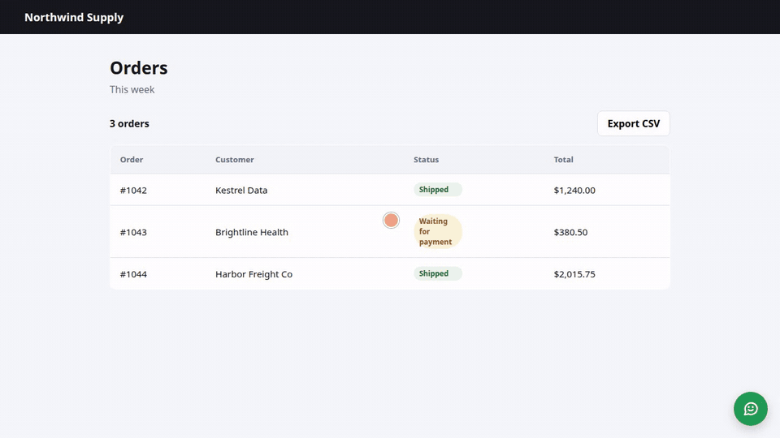
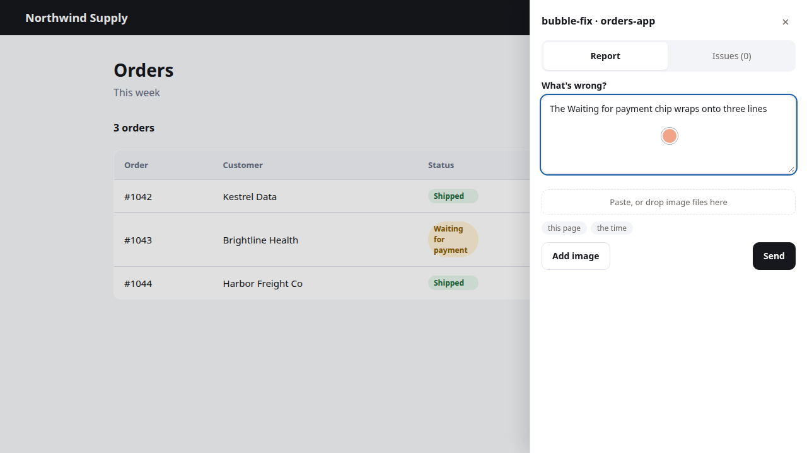
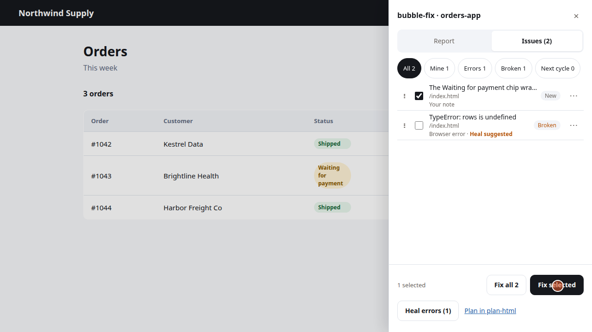

# bubble-fix

**Drop an issue in a bubble inside your app. Your coding agent fixes the ones you pick.**

**[Install](#install)** · [Quick start](#quick-start) · [How a fix cycle works](#how-a-fix-cycle-works) · [Why it matters](#why-it-matters)



bubble-fix is an easy way to give feedback on your app, catch its errors automatically and
have your coding agent fix them. Think of it as a simple maintenance bot for the app you are
building.

It puts a small floating bubble on your app's pages. You type what is wrong, right where you
see it, and it lands in an inbox for that project. The same inbox collects the errors your
pages throw and the errors your back end logs. You pick what to fix, and the agent fixes it
in a cycle that is checked before anything is committed.

Works with **Claude Code** and **Codex**. Runs on your machine, MIT.

⭐ **If this is useful to you, please star the repo.** It is how other people find it.

## Report it where you see it

No screenshot pasted into a chat, no explaining which page you were on. Open the bubble, type
a few words, add an image if it helps, and send. The note records the page it came from.



## Errors are caught for you

Page errors and back-end log errors land in the same inbox on their own. They are scrubbed of
emails and phone numbers, and grouped when they repeat. The list shows your notes and the
errors together, so you choose what goes into the next cycle and in which order.



## A fix cycle, not a one-shot patch

Press **Fix selected** and the agent runs a full cycle on the items you picked:

- **A fix intent in your words.** Your notes are copied exactly into the cycle's `intent.md`.
  Errors go in as facts from the logs.
- **A spec.** The run writes a `spec.md` for the fix before it is judged.
- **A check before commit.** A fresh verifier checks the result against the intent and the
  spec, and a fresh reviewer reads the whole diff. Only then does the run commit.
- **A record.** Each cycle leaves its own folder in your project, so you can see what was
  asked, what was done and how it was checked.

## Or clear the list from your agent

You do not have to press anything in the app. Use the bubble only to capture issues, then
fix them from your harness:

```text
/bubble-fix          # Claude Code: go through the list and fix what you pick
/bubble-fix fast     # fix every open item, no questions, and clear the list
$bubble-fix          # the same skill in Codex
```

## Why it matters

- **Short feedback loop.** From "I saw a problem" to "it is on the list" is a few seconds.
- **Your words reach the agent unchanged.** Nothing is summarized on the way in.
- **It follows the loop from Anthropic's SDLC playbook.** Every fix has an intent, a spec and
  a verify, committed to git, at the size of a bug fix.
- **You stay in charge.** You pick the items and the order. Runs never deploy, push or merge.
- **One inbox, either agent.** Each project picks Claude Code or Codex for its cycles.

## Also in the box

- **Heal cycles:** fix errors in a new git worktree. The branch waits for your OK to merge.
  Heal never starts on its own.
- **Plan in plan-html (optional):** plan the items in rounds in a [plan-html](https://github.com/DoryZi/plan-html)
  deck first, then build from the plan.
- **Off in production:** the loader shows the bubble only on the addresses you register.
  Leave your production address out and it never appears there.
- **Collector service:** one local service (127.0.0.1 only) for every registered project.

## Requirements

- Linux with systemd user services (the collector runs as one; you can also run
  `python bubble_fix.py serve` by hand on any OS)
- Python 3.12 or later and [uv](https://docs.astral.sh/uv/)
- Claude Code and/or Codex, logged in, to run cycles
- git, and an app you can add one script tag to

## Install

In Claude Code:

```text
/plugin install bubble-fix --marketplace DoryZi/bubble-fix
```

Or clone it (the skill finds the tool through `BUBBLE_FIX_HOME`, default `~/bubble-fix`):

```bash
git clone https://github.com/DoryZi/bubble-fix ~/bubble-fix
uv run --directory ~/bubble-fix python bubble_fix.py install   # skill links + collector service
```

`install` links the skill into `~/.claude/skills` and `~/.agents/skills` and starts the
`bubble-fix` systemd user service.

## Quick start

1. Register your app. This also adds the inbox folder to its `.gitignore` and a short rules
   block to its `CLAUDE.md` and `AGENTS.md`:

   ```bash
   uv run --directory ~/bubble-fix python bubble_fix.py register --setup \
     --name my-app --path /path/to/my-app --origin http://localhost:3000 \
     --log 'logs/*.jsonl:jsonl'
   ```

2. Add one line to the app's pages, only where the collector runs:

   ```html
   <script src="http://127.0.0.1:8797/bubble.js" defer></script>
   ```

   The bubble takes the app's own colors and font. Override with `--bubble-fix-*` custom
   properties on `:root`. `bubble_fix.py loader --project my-app --write static/bubble-fix.js`
   writes a loader that only loads on your registered addresses.

3. Open the app, drop an issue in the bubble, pick it in the list and press **Fix selected**.
   Or in Claude Code run `/bubble-fix`, in Codex `$bubble-fix`.

Each project picks its agent: `register --harness codex` runs its cycles with `codex exec`;
the default is `claude -p`.

## How a fix cycle works

1. You pick items in the bubble, in your order, and may add a note for the cycle.
2. The tool makes a cycle folder `cycles/YYYY-MM-DD-NN-fix-cycle-<id>/` in your project with
   `intent.md` (your notes, copied exactly; errors as facts from the logs) and a `spec.md`
   skeleton.
3. A headless run fixes the items and fills the spec. It never deploys, pushes or merges.
4. A fresh verifier checks the result against the intent and spec. A fresh reviewer reads the
   whole staged diff.
5. Only after the verifier says SHIP and the reviewer ends with `REVIEW: NO FINDINGS` does the
   run commit. Items are marked fixed, or left open with the reason.

A heal cycle works the same way on errors only, in a new worktree, and ends with the branch
name and "merge?". Run logs, the review diff and the record stay in the cycle's `.work/`
folder, which is gitignored.

## Known gap in 0.1.0

The verify step of a cycle calls a separate `verify` tool that is not part of this repo yet. Point
`BUBBLE_FIX_VERIFY_DIR` at your own copy, or expect the verify and commit step of a headless run to
stop there. The plugin install line above is untested.

## Where things live

| What | Where |
|---|---|
| Registry (app addresses, log folders) | `state/projects.json` in the tool folder (gitignored) |
| Inbox, images, offsets | `<project>/.bubble-fix/` (gitignored, mode 0600) |
| One folder per cycle | `<project>/cycles/YYYY-MM-DD-NN-fix-cycle-<id>/`: intent.md, spec.md, verify/ |
| A cycle's run log, review diff, record | that folder's `.work/` (gitignored, mode 0600) |
| Collector logs | `journalctl --user -u bubble-fix` |

## Safety

The collector listens on 127.0.0.1 only and answers only registered app addresses (the
browser's Origin header). Headless runs check the login (and for Claude, usage) first, use a
fixed argv with narrow Bash approvals and an allowlisted environment, load no MCP servers,
run one at a time, and never deploy, push or merge.

The approvals limit what a run may do, but they are not a sandbox: a run edits files and runs
your project's tests, and test code can do anything Python can. Use it on your own code with
your own inputs.

## Tests

```bash
uv run --directory ~/bubble-fix --extra dev pytest -q -m "not e2e"   # unit, collector, runner
uv run --directory ~/bubble-fix --extra dev pytest -q -m e2e         # browser tests (Playwright Chromium)
```

## Updating this repo

The source of truth is a private working copy. `scripts/sync-from-source.sh` regenerates
this repo from it and makes the files portable; do not edit the synced files here.

## License

MIT, see [LICENSE](LICENSE).

## About

Built by [Dory Zidon](https://doryzidon.com).
Bugs and ideas are welcome in [Issues](https://github.com/DoryZi/bubble-fix/issues).
